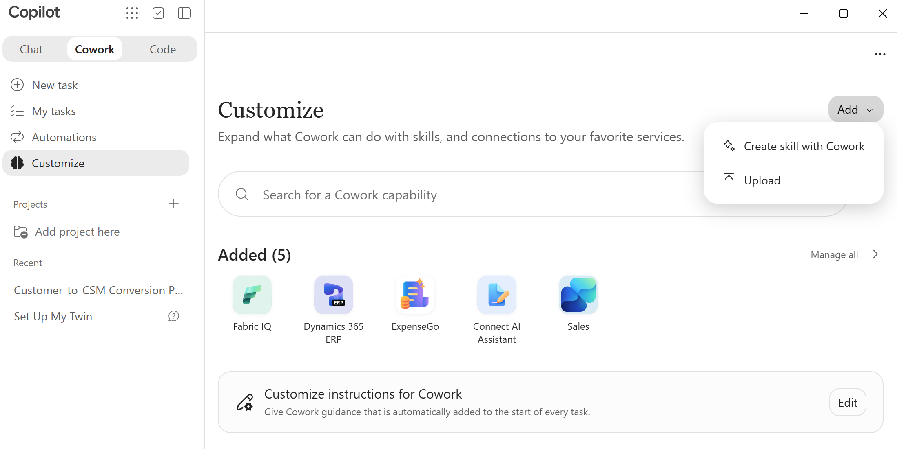

# Installing CSM Advisor in Cowork

**CSM Advisor** reads your Word, PDF, text, PowerPoint, and Excel files and gives you back
one combined summary plus a suggested learning path. No technical setup is needed - just download
the plugin and add it in Cowork.

## 1. Download

Download the plugin ZIP using the link below. It always points to the newest version - you don't
need to build or unzip anything yourself:

[**Download CSM Advisor**](https://github.com/true-while/CSM-advisor/releases/latest/download/CSM-advisor.zip)

<!-- latest-version:start -->
Latest published version: **v1.1.4** (released 2026-11-11) - [release notes](https://github.com/true-while/CSM-advisor/releases/tag/v1.1.4)
<!-- latest-version:end -->

Keep the downloaded `CSM-advisor.zip` file intact - don't unzip it or edit its contents.
(Every past version also stays available on the [Releases page](https://github.com/true-while/CSM-advisor/releases) if you ever need an older one.)

## 2. Install in Cowork

1. Open **Cowork > Customize > Add > Upload**.
2. Select **choose a file** and pick the `CSM-advisor.zip` you downloaded, or drag and drop it into the dialog.
   


1. Follow the on-screen installation and consent steps.
2. Confirm **CSM Advisor** appears in your installed plugins list.


## 3. Try it out

Start a new Cowork conversation and paste in the prompt below (attach 2 or more files first - any
mix of Word, PDF, text, PowerPoint, and Excel):

```text
Summarize these files into one combined summary using CSM Advisor: <attach/select 2+ files
in Word, PDF, text, PowerPoint, and/or Excel format>.
```

You should get back one combined summary covering all of the files together, not a separate
summary per file.

## Updating to a newer version

When a new version is published, repeat the install steps above with the same download link -
Cowork will update the existing plugin in place rather than installing a second copy.

---

## For maintainers

To ship a change to this plugin:

1. Make your changes under `skills/csm-advisor/`.
2. Push to `main`. Every push triggers the release workflow
   ([.github/workflows/release.yml](.github/workflows/release.yml)), which automatically
   increments the patch version (e.g. `1.1.3` -> `1.1.4`), updates `version` in `manifest.json` and
   `SKILL.md`, builds the ZIP, publishes it as a new GitHub Release tagged `v<version>`, and updates
   the "Latest published version" line above - the download link always serves the newest release.
   (You can also trigger the workflow manually from the **Actions** tab.)

You don't need to edit the version by hand. To start a new major/minor line, set `version` in
`manifest.json` to e.g. `1.2.0` (with no existing `v1.2.0` tag) and push; later pushes continue from
there. Run `git pull` after a push to get the bot's version-bump commit.

Keep the same `id` (GUID) in `manifest.json` across updates so Cowork treats it as an update to the
existing plugin rather than a new installation. The release workflow never overwrites or replaces an
already-published version.
